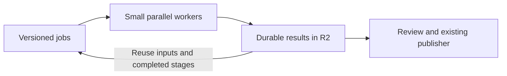

# Small parallel coding-agent jobs in the cloud

Use this reference when moving scripted coding-agent work into cloud containers.
The goal is **many small, useful jobs completing concurrently**, with reusable
inputs and durable results—not a local pipeline copied into one large container.
Use the task's selected CLI and `$MODEL_ID`; no model substitution is implied.

## Goals

- Keep compute temporary and data durable. A laptop disconnect or retired
  container must not lose accepted work or require starting the batch again.
- Scale independent tasks, not entire monolithic runs. A slow item must not hold
  up unrelated work, and finished items should reach users continuously.
- Reuse expensive preparation. Archive once, extract once when inputs match,
  and regenerate only the fields affected by a change.
- Measure useful output: accepted items per hour and cost per accepted item.
  Container count, deployed code and successful model exits are intermediate facts.

## The simple design

A small control service owns job state and enforces shared capacity and budget.
Workers fetch only their inputs, execute one bounded stage, retain their results,
and stop. The existing product consumes accepted published resources.

In the AI Engineer implementation, a Cloudflare Worker exposed the job API,
Durable Objects held job ownership and shared admission, and Containers ran the
coding-agent CLI or media tools. R2 held source media, intermediate artifacts and
results. These are implementation choices, not a requirement to introduce a
separate service for every box in a diagram.

The next step is to move remaining local scheduling and assembly into this same
system. The laptop should submit, inspect and review; it should not shuttle bulk
artifacts or remain awake for the batch to finish. Extend the existing runner and
publisher rather than building parallel systems.

## Decisions that enable parallelism

| Decision | Why it matters |
| --- | --- |
| Split by independently resumable stage | Download/extraction, image-group transcription, description, review and assembly need different resources. A container need not wait through the whole talk. |
| Separate media and model capacity | Decoding can be CPU/storage-heavy; model wrappers mostly need a few images and text. One lane should not unnecessarily throttle the other. |
| Share account limits and budget | Per-talk pools must not multiply the account-wide allowance. More containers do not create more subscription quota. |
| Refill ready slots continuously | Avoid batch barriers. Finish/review ready outputs while other talks are still preparing. Reserve allowance for required reviews and repairs. |
| Pass immutable object references | Workers fetch checksum-qualified inputs directly from storage, not through the laptop or another long-lived worker. |
| Cache by effective inputs | Bind source, images, transcript, prompt, schema and model versions. A description change should not redownload video or rerun accepted transcription. |
| Keep prompts separate from runtime releases | Submit versioned content jobs without rebuilding the container or frontend. Release runtime code when executable behavior changes. |

Start with the existing queue/owner mechanism. Add a workflow engine, another
queue or warm-worker reuse only when it solves an observed scheduling, recovery
or cold-start problem. Those are optional optimizations, not prerequisites.

## Size the task, not the whole corpus

**The earlier assumption that every worker needed 20 GB was wrong.** That was a
local batch headroom rule carried into a different execution model. A small
model job needs its image group and text, not the entire source video or corpus.
Local disk pressure is relevant only while local preparation/assembly still
exists; it is a dependency to remove, not an inherent cloud-workload requirement.

Illustrative decimal-unit bounds—not measured peaks or instance specifications:

- 150 selected images at 100–500 KB each: **15–75 MB** for a whole talk.
- 150 gallery thumbnails at 15–50 KB each: **2.3–7.5 MB**.
- One hour of source video at 1–4 Mbps: **450 MB–1.8 GB**.
- One hour of compressed audio at 64–128 kbps: **29–58 MB**.

An individual model request uses a subset of those images. Add measured runtime,
buffers and temporary-copy overhead when selecting a worker size. Chunk long
workshops or use a larger media worker for outliers; do not size every model
worker for the largest recording. Memory, scratch disk and durable storage are
separate quantities.

## Durable storage and safe retries

Keep original sources private and reusable according to the owner's retention
policy; this project chose indefinite R2 retention. Keep candidates, requests,
native responses and review evidence private too. Publish accepted assets through
the existing immutable resource paths, reusing matching objects. Container-local
scratch is disposable, not a recovery archive.

The non-obvious ordering is:

1. **Persist identity and ownership before dispatch.** Retain the exact request
   and reserve shared capacity/budget. In this implementation the job ID hashes
   `JSON.stringify(job) + '\n'`; equivalent JSON with different bytes is a
   different ID. Retry by the original identity, not reconstructed input.
2. **Check the running image before inference.** Verify its supported model,
   schema and stages. A successful Worker deployment does not prove every
   container is using the expected image.
3. **Retain output before acknowledging completion.** A successful CLI exit is
   delivery, not content acceptance. Review the exact retained output.
4. **Terminate compute before releasing its capacity.** A cleanup request or idle
   timeout is not verified termination. Failed cleanup retries cleanup, not the
   model job; retain the result and original accounting.

After dispatch, a network timeout can mean the response was lost while inference
continued. Record unknown delivery, inspect the existing owner/result and retain
its original charge. Do not blindly replay it. This provides durable dispatch
control, not an exactly-once guarantee inside an external model provider.
Independent jobs can continue when their capacity and budget are available.

Keep operator authorization, per-job artifact/callback capabilities and model
login separate. Provision authorized credentials through the configured secret
mechanism, never job payloads or logs. Subscription model usage and Cloudflare
compute/storage charges are different costs; do not silently fall back to paid
API inference. Missing model or billing telemetry stays unavailable.

## What the talk workload taught us

The historical and new-recording paths should converge on the same stages:

`source archive → extraction + available transcript → descriptions/review → assembly → publication`

Historical enrichment reuses accepted transcripts, articles and profiles. New
recordings additionally need transcription and the existing editorial workflow;
independent article/profile work can overlap slide work.

Preserve three distinct outputs: literal image text for search, an interpretation
using pixels and surrounding speech/slides, and private evidence/review. An
accepted description does not establish that literal transcription exists.
Context can clarify visible text but must not insert speech-only claims into OCR.
Keep accepted descriptions when repairing missing transcription.

These were incorrect assumptions or costly approaches from the implementation:

| Assumption or approach | Correction |
| --- | --- |
| Every container needs the local batch's disk allowance | Size each stage from its actual inputs and measured overhead. |
| Remote model calls make the whole pipeline cloud-native | Local artifact staging and assembly still tie completion to the Mac. Move those executors, not just inference. |
| Hundreds of inactive container records mean hundreds of running machines | Inspect active runtime and container-seconds. Lingering running containers are a real capacity/cost problem; retained records alone are not. |
| More containers automatically increase throughput | Find the constrained lane: preparation, model quota, review or publication. Increase concurrency where accepted-output throughput improves. |
| All old jobs must disappear before any new work | Recover uncertain owners separately; admit independent jobs against verified spare capacity. |
| A deployment or local test proves lifecycle cleanup | Exercise the failed path on one real container: retained result, termination, capacity release. |
| Every diagnostic change needs another full release cycle | Diagnose from retained evidence, iterate with focused tests, then batch confirmed fixes into the candidate required by repository policy. |
| Archive reuse can begin with a fresh download/metadata request | Check usable retained source evidence first; unnecessary upstream calls add latency and failure points. |
| Successful scanning proves frame capture works | Exercise the actual representative-frame decoder; the AV1 failure occurred on a different capture path. |

## Measure, then expand

Use the task's approved budget and scale-up boundary. Measure accepted-item
throughput, queue wait, execution/review time, retries, cold starts, cleanup lag
and storage reuse over a stated workload/window. Model tokens and Cloudflare
container/storage usage remain separate. Conservative cost reservations are not
actual bills; account for retained storage after compute stops.

For a lifecycle repair, stop after the affected real-cloud path is proven. For a
content change, inspect the changed output. For publication, verify the actual
page and relevant interactions. Resume tests, new-recording tests and larger
mixed batches are needed when claiming those capabilities—not mandatory gates
for every small fix. Reuse valid proof for unchanged components.

After a representative sample is accepted, increase concurrency within authorized
limits while completion rates, quality and resource health support it. Deliver
finished talks in batches with clickable results rather than waiting for the
entire backlog. Do not confuse a completed sample with completed rollout.

## Implementation pointers and evidence boundary

This case study comes from AI Engineer's October 17–18, 2026 work, anchored to
[source candidate d7447f1](https://github.com/aiDotEngineer/aiecode2025/tree/d7447f182ec277bbf6cb9cdbb88cc3e736edc522).
Selected-slide model jobs had produced published output. At the inspected
snapshot, the no-slides canary was incomplete and local assembly remained.
That is historical evidence, not a current production-status report.

- `workers/knowledge-prep/slides/`: job API, ownership, admission, CLI wrapper.
- `workers/knowledge-prep/media/`: source archive and extraction.
- `scripts/knowledge/slides/cloud-*.{mjs,ts}`: adapters, orchestration and staging.
- `scripts/knowledge/slides/description-context.mjs` and
  `transcription-context.mjs`: interpretation and literal-text contracts.
- `scripts/knowledge/data-release.mjs`: existing guarded publication.

Use source and current run receipts for exact limits and commands. This reference
preserves design lessons, not incident-specific budgets or authorization.
