# Followed-account examples, grouped by intent

**36 examples.** Collected on October 21, 2026.
Each author was found in @swyx's followed-account search or verified in
[@swyx's following list](https://x.com/swyx/following). The displayed follower
count was under 200,000, except for @aakashgupta, the user's explicit exception.
Each post had at least 200 likes when observed. Follower and like counts are
snapshots, and high engagement does not establish why a post succeeded.
The additional examples use X's public embedded-post data or a named archive
for likes and attachment metadata; those counts may be cached. Their authors'
follow relationships and follower counts were observed in the earlier X
session. Some longer posts were read in full in archived copies, as noted below.

The longer posts are linked to their complete original text; short posts are
reproduced in full. Screenshots show the original attached image, a video frame,
or a linked article, as labeled; they are not substitute visuals.

## Launch a product or model

### Launch a research lab with a mission and concrete asks

- [@natolambert — Trillium Labs](https://x.com/natolambert/status/2106060179985019085), October 2, 2026; 106.1K followers; 3,282 likes in X's embedded-post data. Earlier authenticated research observed that @swyx followed the author.
- Full text: [read the original](https://x.com/natolambert/status/2106060179985019085); the complete post was also read in an [archived profile](https://nitter.rdrama.net/natolambert).
- Format: announce the lab and its work, explain its theory of change through an extended metaphor, then name the cofounder and make specific hiring, funding and compute asks. The direct attachment is a simple lab identity graphic.

### Short launch exclamation with an onstage photo

- [@milichab — Notion Mail](https://x.com/milichab/status/1849527370811908567), October 24, 2024; 64.8K followers; 664 likes in X's embedded-post data. The profile previously showed @swyx was following.
- Full post:

  > YOU'VE GOT MAIL!!! @NotionHQ @notionmail https://t.co/oWtNrkztXu

- Format: a short product-related exclamation and account tags, paired with a directly attached photo of the launch presentation and product interface.

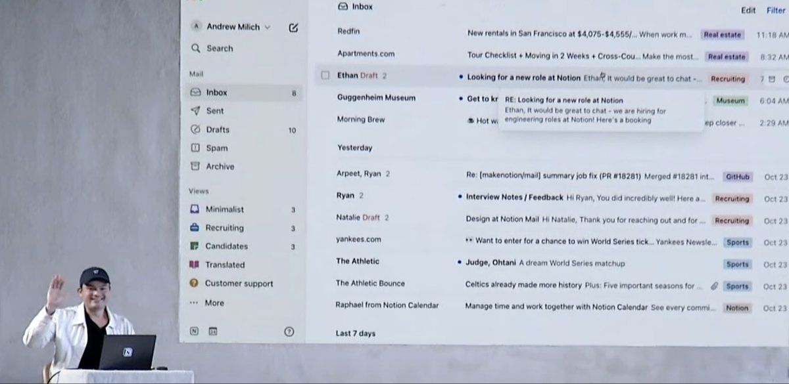

### Direct launch with a playable demo

- [@milichab — Iso-Coaster](https://x.com/milichab/status/2017132008934428963), January 29, 2026; 64.8K followers; 11,404 likes. The profile showed @swyx was following.
- Full post:

  > Now launched: iso-coaster.com
  >
  > Free, open-source coaster park builder with shops, water/metal/wooden coasters, guests, food, shops, and more
  >
  > No signup required, co-op included

- Format: launch announcement, product description, access conditions, then a directly attached 18-second gameplay video.

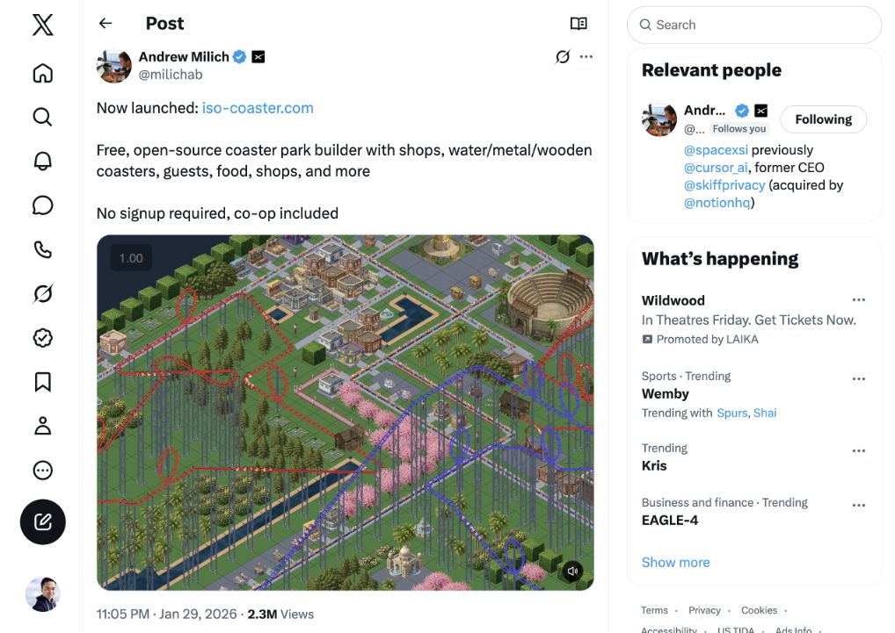

### Product launch with proof points and a demo

- [@hehe6z — Fish Audio S1](https://x.com/hehe6z/status/1980303682932744439), October 20, 2025; 2,469 followers; 3,569 likes. The profile showed @swyx was following.
- Full text: [read the original post](https://x.com/hehe6z/status/1980303682932744439). The post is too long to reproduce here.
- Format: announce the product, list three specific claims as bullets, invite people to try it, and attach a 1:02 product video. The numbers are the author's claims.

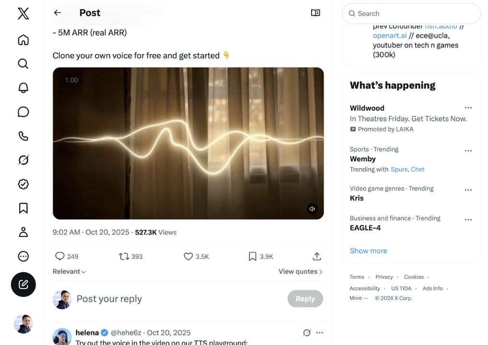
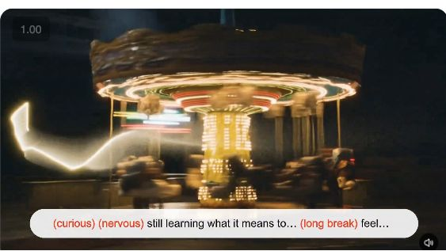

### Answer a question with a feature launch

- [@mxstbr — ChatGPT Sites and MCP servers](https://x.com/mxstbr/status/2105428405571428785), September 30, 2026; 57.7K followers; 1,595 likes. The profile showed @swyx was following.
- Full text: [read the original post](https://x.com/mxstbr/status/2105428405571428785). The post is too long to reproduce here.
- Format: quote an audience question, announce the feature, show an example prompt, and enumerate what the feature does. The post has no attached image or video.

### Founder announcement with video

- [@bertgodel — Ultramarine 1 Flash](https://x.com/bertgodel/status/2110400987622265232), October 14, 2026; 8,335 followers; 8,099 likes.
- Full text: [read the original post](https://x.com/bertgodel/status/2110400987622265232). The complete post was read but is too long to reproduce here.
- Format: announce the release, specify positioning and availability, then attach a founder-led video with benchmarks. The capture is a frame from the directly attached 1:17 video.

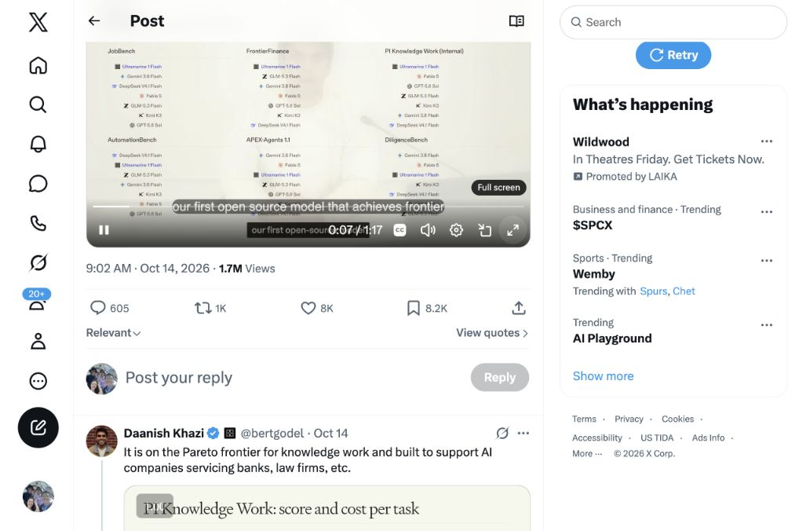

### Model announcement with an architecture diagram

- [@GoogleResearch — TimesFM-3](https://x.com/GoogleResearch/status/2094483372718580066), August 31, 2026; 120.3K followers; 11,518 likes. The profile showed @swyx was following.
- Full text: [read the original post](https://x.com/GoogleResearch/status/2094483372718580066). The post is too long to reproduce here.
- Format: announce a model with a technical diagram showing its architecture.

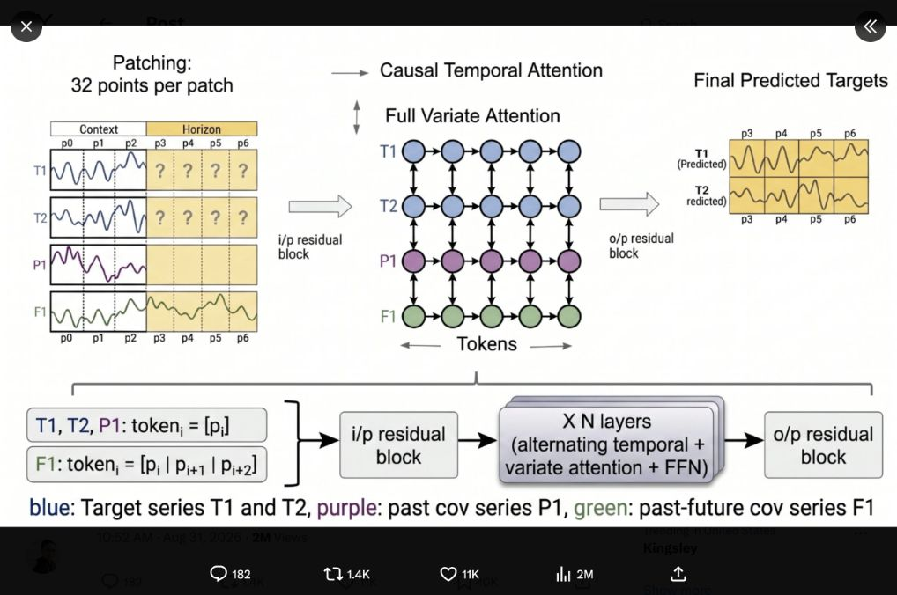

### Model announcement with a simple concept graphic

- [@GoogleResearch — TabFM](https://x.com/GoogleResearch/status/2072057987762708932), June 30, 2026; 120.3K followers; 5,613 likes. The profile showed @swyx was following.
- Full text: [read the original post](https://x.com/GoogleResearch/status/2072057987762708932). The post is too long to reproduce here.
- Format: announce a model and attach a simple input → model → output graphic.

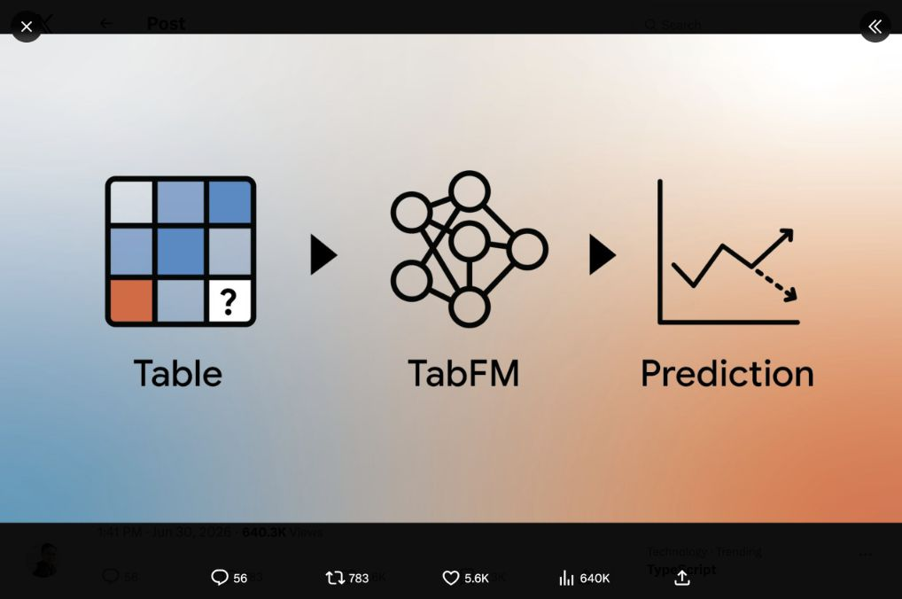

## Promote a company milestone

### Funding announcement through customer stories

- [@quintendf — Tolan funding and film](https://x.com/quintendf/status/2112219577727992319), October 19, 2026; 6,270 followers; 1,034 likes. The profile showed @swyx was following.
- Full text: [read the original post](https://x.com/quintendf/status/2112219577727992319). The post is too long to reproduce here.
- Format: open with the founding vision, ground it in customer situations, give traction and funding details, and close with a directly attached 1:45 film.

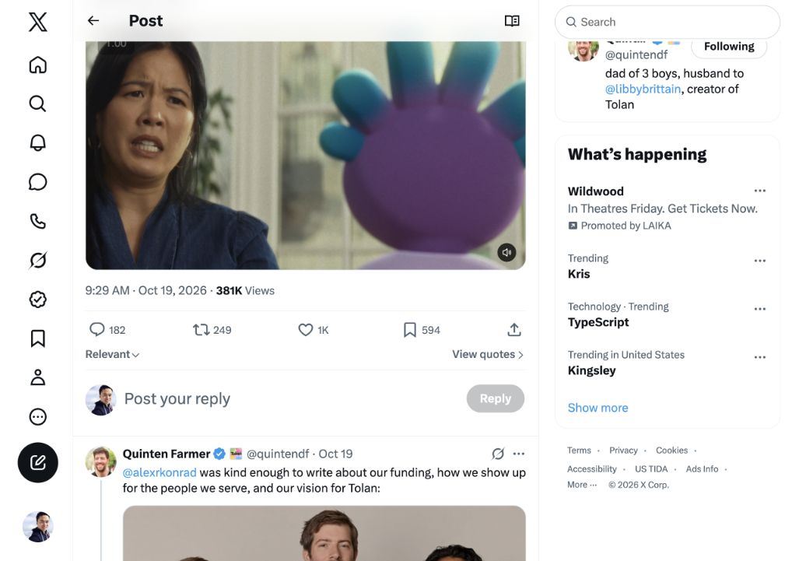

## Invite people to join a team

### Share a personal reason for joining with a film

- [@jxnlco — OpenAI recruiting video](https://x.com/jxnlco/status/2082855170296205719), July 30, 2026; 139.3K followers; 3,062 likes in [SuperX's indexed snapshot](https://superx.so/creators/jxnlco). The profile previously showed @swyx was following.
- Full text: [read the original](https://x.com/jxnlco/status/2082855170296205719); the complete post was also read in the linked archive.
- Format: start from a personal view of the workplace, explain why he made the video, and connect that personal story to an invitation to join. The post directly attaches a 1:43 film; the image below is a frame from the playing video.

## Promote a podcast or technical conversation

### Announce an episode as a head-to-head test

- [@omooretweets — agentic browser podcast](https://x.com/omooretweets/status/1947687371748872198), July 22, 2025; 155.5K followers; 1,408 likes in X's embedded-post data. The profile previously showed @swyx was following.
- Full text: [read the original](https://x.com/omooretweets/status/1947687371748872198); the complete post was also read in an [archived thread](https://threadreaderapp.com/user/omooretweets). Opening: “New @a16z podcast - it's the battle of the agentic browsers!”
- Format: announce the episode as a contest, describe a week-long firsthand test, and leave the winner as a question. The direct attachment turns the comparison into a versus graphic, with product screens behind it.

### Episode launch with a thesis and timestamps

- [@bhalligan — Long Strange Trip episode](https://x.com/bhalligan/status/2039750651643875617), April 2, 2026; 106.9K followers; 1,677 likes. The profile showed @swyx was following.
- Full text: [read the original post](https://x.com/bhalligan/status/2039750651643875617). The post is too long to reproduce here.
- Format: name the guests, state the conversation's central thesis, spell out an audience, add a timestamped agenda, and attach the full 63:41 episode. The author's next post links to podcast platforms.

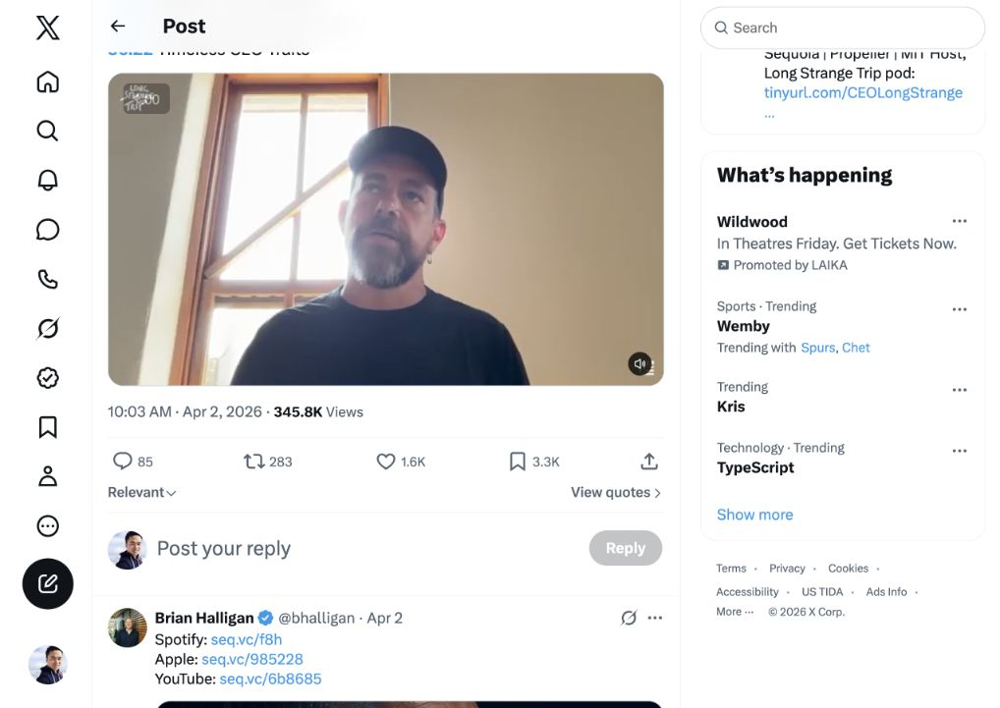

### Whiteboard discussion

- [@philipkiely — inference discussion](https://x.com/philipkiely/status/2112272656217297224), October 19, 2026; 15.9K followers; 1,898 likes.
- Full text: [read the original post](https://x.com/philipkiely/status/2112272656217297224). The complete post was read but is too long to reproduce here.
- Format: introduce a recorded conversation through specific engineering questions; the directly attached long video shows the speakers working at a whiteboard.

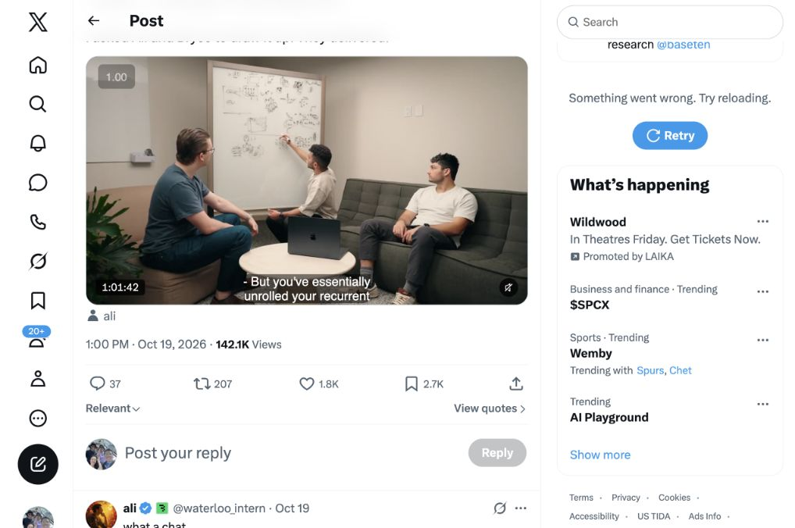

### Promote an episode through a substantive quote post

- [@waterloo_intern — inference masterclass](https://x.com/waterloo_intern/status/2084426439034540297), August 3, 2026; 36.1K followers; 1,630 likes. The profile showed @swyx was following.
- Full text: [read the original post](https://x.com/waterloo_intern/status/2084426439034540297). The post is too long to reproduce here.
- Format: open with a mock apology, lay out several predictions, and quote the episode. Three images belong to the author's post; the video belongs to the quoted Latent Space post.

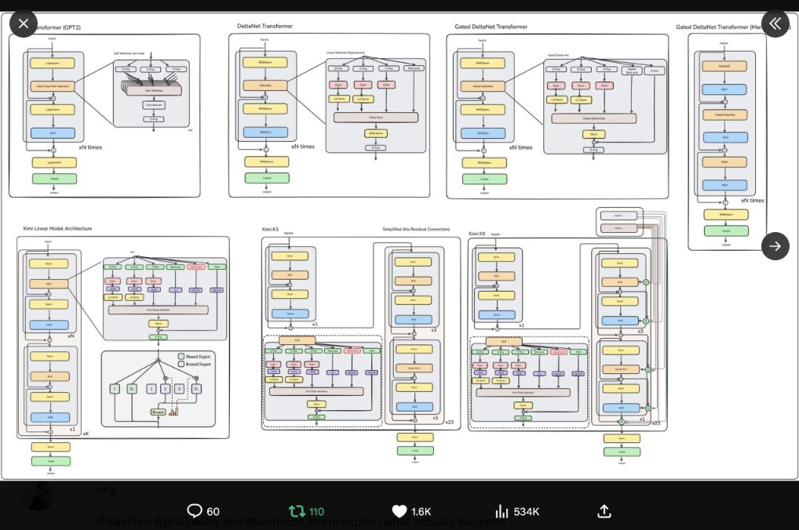
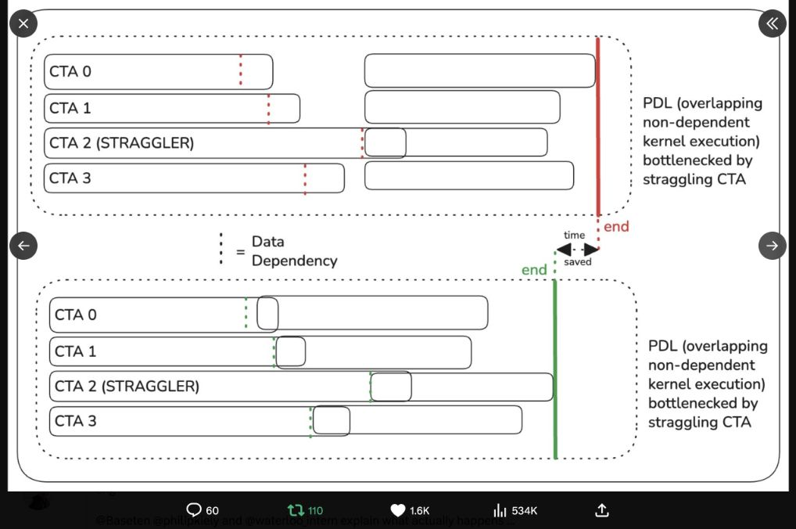
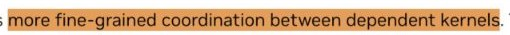
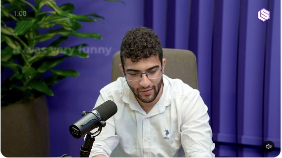

## Announce an essay or research

### Launch a book with a one-line announcement and a film

- [@philipkiely — Inference Engineering](https://x.com/philipkiely/status/2025994823891914795), February 23, 2026; 15.9K followers; 2,504 likes in X's embedded-post data. Earlier authenticated research observed that @swyx followed the author.
- Full post:

  > Inference Engineering launches today. https://t.co/UNEIty1xZg

- Format: announce the book in a single sentence and link to it; the directly attached 1:12 video does the rest. The capture is a frame from the video.

### Turn a talk into a practical thread

- [@geoffreylitt — understanding agent-written code](https://x.com/geoffreylitt/status/2072522251300409556), July 2, 2026; 26K followers; 3,304 likes in the earlier authenticated X observation. @swyx followed the author and liked this post.
- Full text: [read the original](https://x.com/geoffreylitt/status/2072522251300409556); the complete opening post was also read in an [archived thread](https://threadreaderapp.com/user/geoffreylitt).
- Format: open with a pointed thesis, credit the talk behind the thread, and promise both a rationale and practical techniques. The directly attached image is the talk's thesis slide.

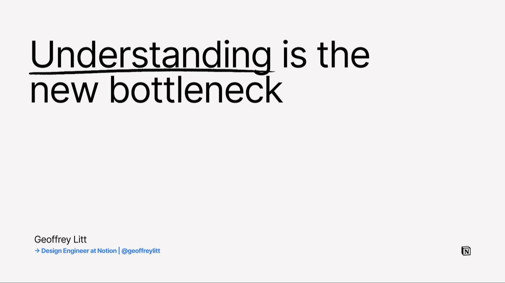

### Promote an essay with a personal worklog and video

- [@waterloo_intern — Kimi K3 essay promotion](https://x.com/waterloo_intern/status/2081762991532560503), July 27, 2026; 36.1K followers; 9,675 likes in X's embedded-post data. Earlier authenticated research observed that @swyx followed the author.
- Full text: [read the original](https://x.com/waterloo_intern/status/2081762991532560503); the complete post was also read in an [archived profile](https://twiscan.com/en/x/waterloo_intern).
- Format: lead with time spent on the work, list a humorous inventory of the effort, and close with the scope of the essay. The post directly attaches a 27-second video and quotes the author's article post. The first capture is an actual video frame; the second is the linked article.

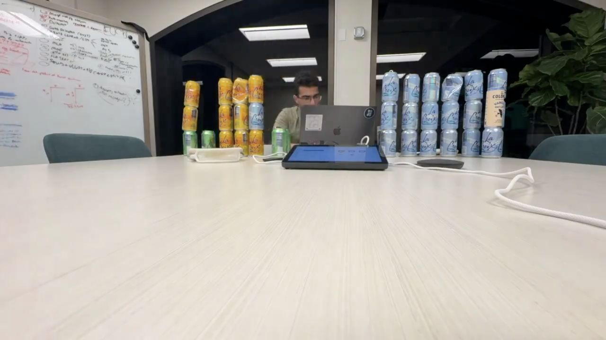
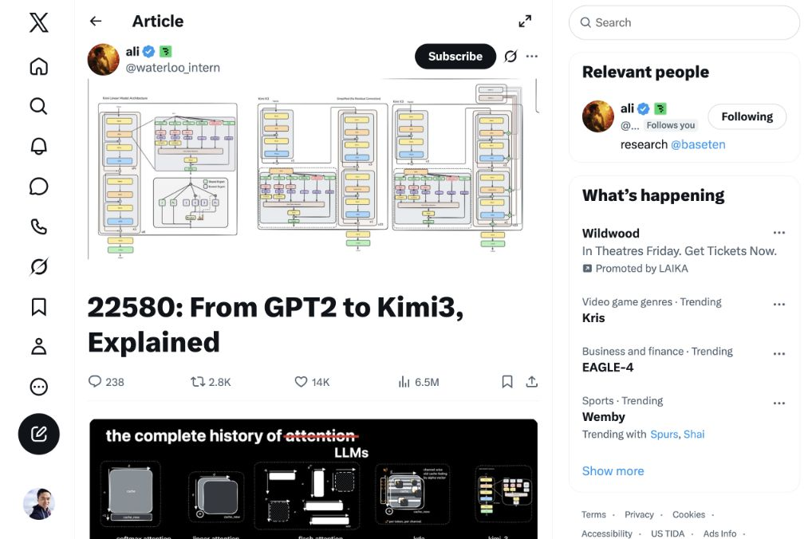

### Relaunch a recurring report with a change in method

- [@omooretweets — Consumer AI Top 150](https://x.com/omooretweets/status/2107125913012039910), October 5, 2026; 155.5K followers; 567 likes in X's embedded-post data.
- Full text: [read the original](https://x.com/omooretweets/status/2107125913012039910); the complete opening post was also read in an [archived thread](https://threadreaderapp.com/user/omooretweets).
- Format: announce that an established list has expanded, explain the newly added revenue data, state one finding, then point to the takeaways. Three directly attached charts show the revenue, web-usage and mobile-usage rankings.

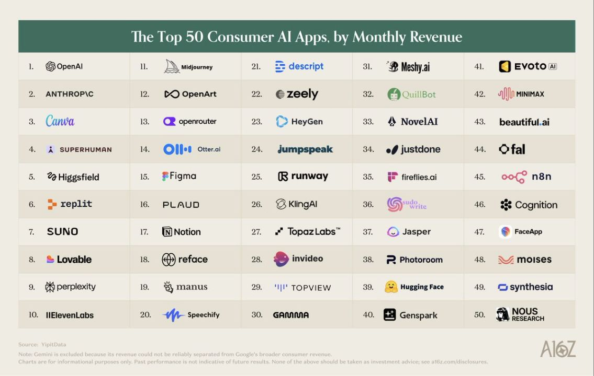
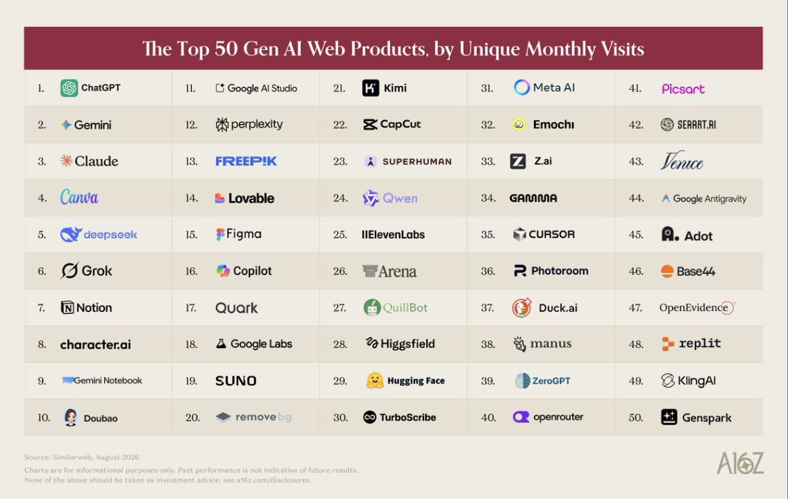
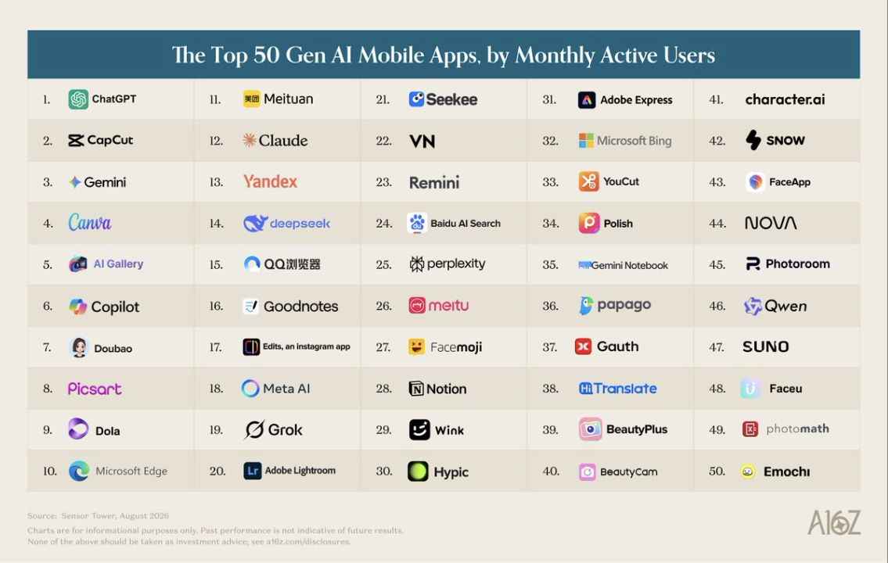

### Launch a recurring ranking with a personal reaction

- [@omooretweets — fifth Top 100 AI apps report](https://x.com/omooretweets/status/1960726780681376028), August 27, 2025; 155.5K followers; 1,025 likes in X's embedded-post data.
- Full text: [read the original](https://x.com/omooretweets/status/1960726780681376028); the complete post was also read in an [archived thread](https://threadreaderapp.com/user/omooretweets).
- Format: announce the new edition, explain the ranking's scope, add the author's reaction to the results, and point to the takeaways. Two direct attachments show the web and mobile rankings.

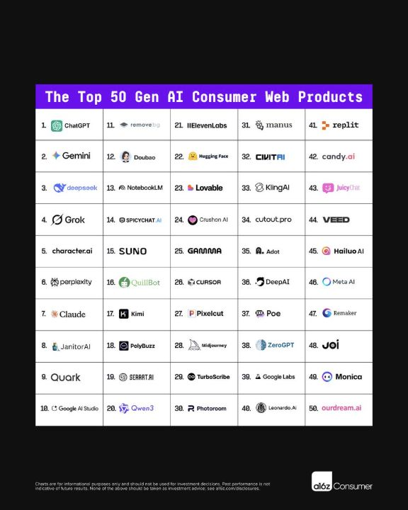
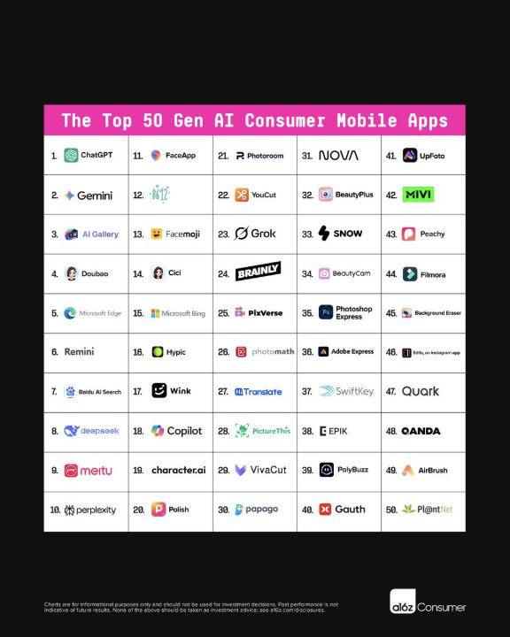

### Launch a ranking with a reason to read the analysis

- [@omooretweets — fourth Top 100 AI apps report](https://x.com/omooretweets/status/1897686004640960562), March 6, 2025; 155.5K followers; 1,093 likes in X's embedded-post data.
- Full text: [read the original](https://x.com/omooretweets/status/1897686004640960562); the complete post was also read in an [archived copy](https://krynsky.com/ai-candy-1/).
- Format: announce the fourth edition, specify the two usage measures, note changes since the previous report, and point to the team's trends. The two direct images are ranked web and mobile lists.

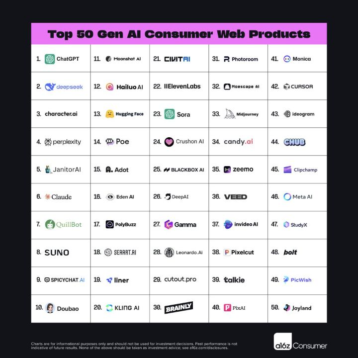
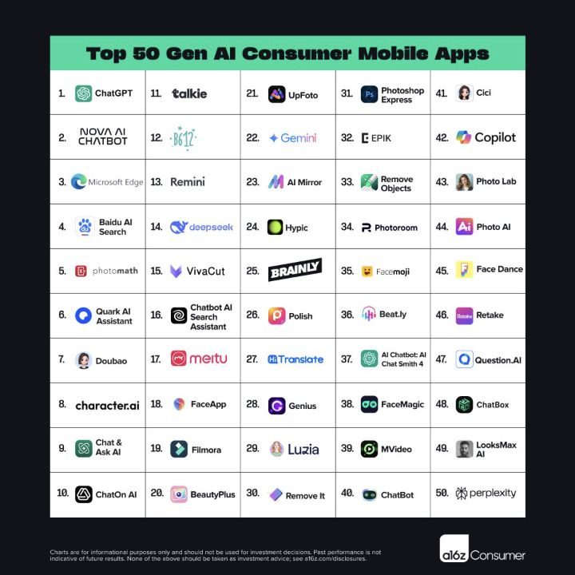

### Share benchmarks with numbers and a compact interpretation

- [@omooretweets — startup revenue benchmarks](https://x.com/omooretweets/status/1931750864622121338), June 8, 2025; 155.5K followers; 1,116 likes in X's embedded-post data.
- Full text: [read the original](https://x.com/omooretweets/status/1931750864622121338); the complete wording was also visible in a cached [public index](https://ww.twstalker.com/dhaber).
- Format: label the post as a data release, announce the research, contrast two headline metrics, then add a short interpretation. The directly attached table provides the B2B and B2C revenue ramp across multiple periods.

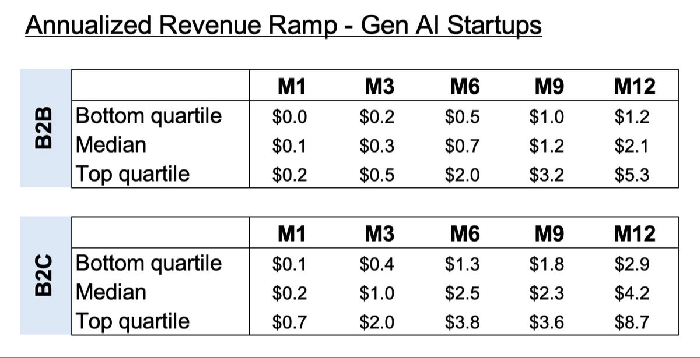

### Launch a market map with a thesis

- [@omooretweets — AI productivity tools market map](https://x.com/omooretweets/status/1760000618557735289), February 20, 2024; 155.5K followers; 1,512 likes in X's embedded-post data.
- Full text: [read the original](https://x.com/omooretweets/status/1760000618557735289); the complete wording was also visible in cached public indexes, including [this one](https://w.twstalker.com/getnotus).
- Format: name the new artifact and its field, frame the shift in productivity tools, and invite readers into the map. The directly attached graphic categorizes products by task.

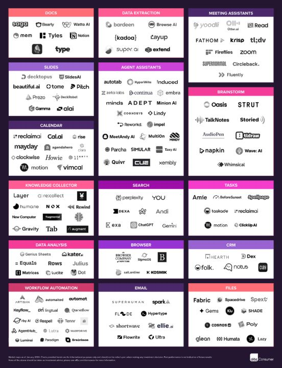

### Share an article as the post

- [@waterloo_intern — 22580](https://x.com/waterloo_intern/status/2081762065392541951), July 27, 2026; 36.1K followers; 14,501 likes in X's embedded-post data.
- Full post: [https://t.co/aivc7B4A7Z](https://t.co/aivc7B4A7Z)
- Format: the post consists of a link to the author's X article, whose title and cover carry the presentation. The image below is a capture of the linked article, not a direct attachment to the post.

### Publish a technical worklog as an article link

- [@waterloo_intern — video kernel worklog](https://x.com/waterloo_intern/status/2070643039668974060), June 26, 2026; 36.1K followers; 858 likes in X's embedded-post data. The profile previously showed @swyx was following.
- Full post: https://t.co/qe2HpEQZPd
- Format: the post is a link to an X article titled “some notes on writing the fastest video kernel in the world.” The capture below is the article's cover, obtained from X's public media CDN; it is not a separate direct photo attachment.

### Invite feedback on a draft

- [@jxnlco — Codex draft](https://x.com/jxnlco/status/2056139571641872765), May 17, 2026; 139.3K followers; 3,613 likes in X's embedded-post data.
- Full post:

  > jason from the codex team here,
  > heres a draft on codex maxxing and the primatives i use on a daily basis
  >
  > https://t.co/DR4N6xtAwe
  >
  > would love any feedback

- Format: establish the author's connection to the subject, describe the draft, link it, and ask for feedback. X's embed identifies a text-only link card; no direct image or video is listed. The [draft](https://jxnl.github.io/blog/writing/2026/05/10/codex-maxxing/) is the linked artifact.

### An essay with an image of the work

- [@Hi_Mrinal — Redis 101](https://x.com/Hi_Mrinal/status/1973796086411034888), October 2, 2025; 24.2K followers; 3,382 likes.
- Full post:

  > Wrote a blog on Redis 101, link in the comments

- Format: one plain sentence announcing the essay; the [author's first reply](https://x.com/Hi_Mrinal/status/1973796090140049688) contains the link. The attached image shows the essay. A link in the comments is one observed choice, not a rule.

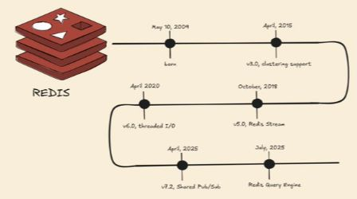

### A casual essay announcement with an image of the work

- [@Hi_Mrinal — exponents essay](https://x.com/Hi_Mrinal/status/2031043400288624672), March 9, 2026; 24.2K followers; 225 likes in X's embedded-post data. The profile previously showed @swyx was following.
- Full post:

  > Wrote about exponents in my free time 🤠
  >
  > https://t.co/TEH2qJkD1S https://t.co/ffpcI64GLb

- Format: a casual one-line announcement, a link, and a direct image of the essay. The original image was viewed and captured from X's public media CDN.

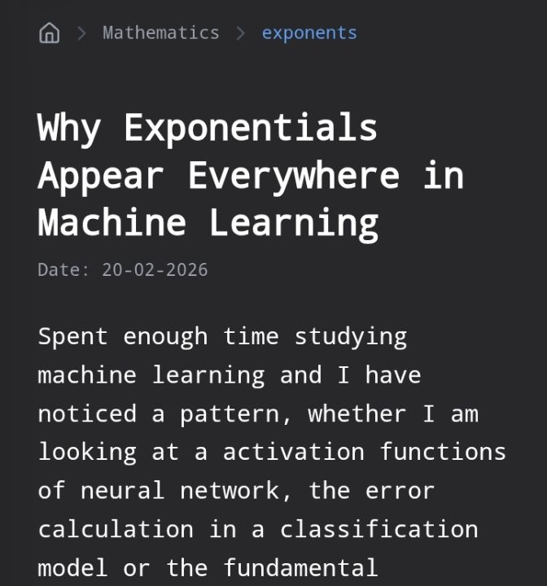

### Research or ranking announcement

- [@omooretweets — AI Apps 50](https://x.com/omooretweets/status/1973778394358976912), October 2, 2025; 155.5K followers; 1,549 likes.
- Full text: [read the original post](https://x.com/omooretweets/status/1973778394358976912). The complete post was read but is too long to reproduce here.
- Format: announce a research artifact and pair it with the artifact's visual.

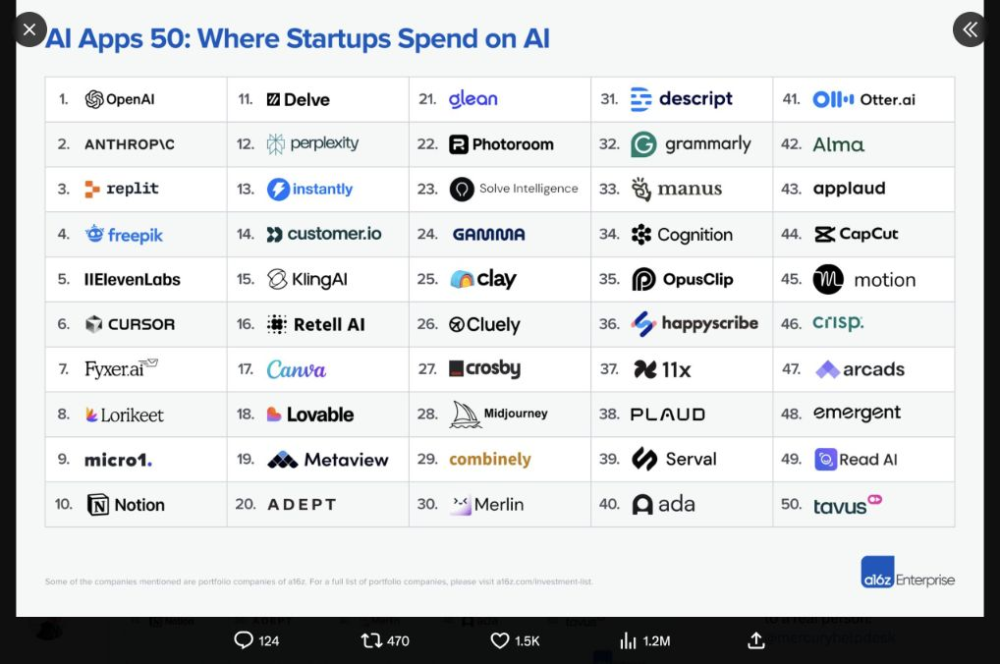

### Launch a research initiative with the results visualized

- [@EpochAIResearch — Benchmark Reviews](https://x.com/EpochAIResearch/status/2100704765332394255), September 17, 2026; 76.7K followers; 1,934 likes. The profile showed @swyx was following.
- Full text: [read the original post](https://x.com/EpochAIResearch/status/2100704765332394255). The post is too long to reproduce here.
- Format: introduce the initiative, state the outcomes, and attach a graphic grouping the reviewed benchmarks by verdict.

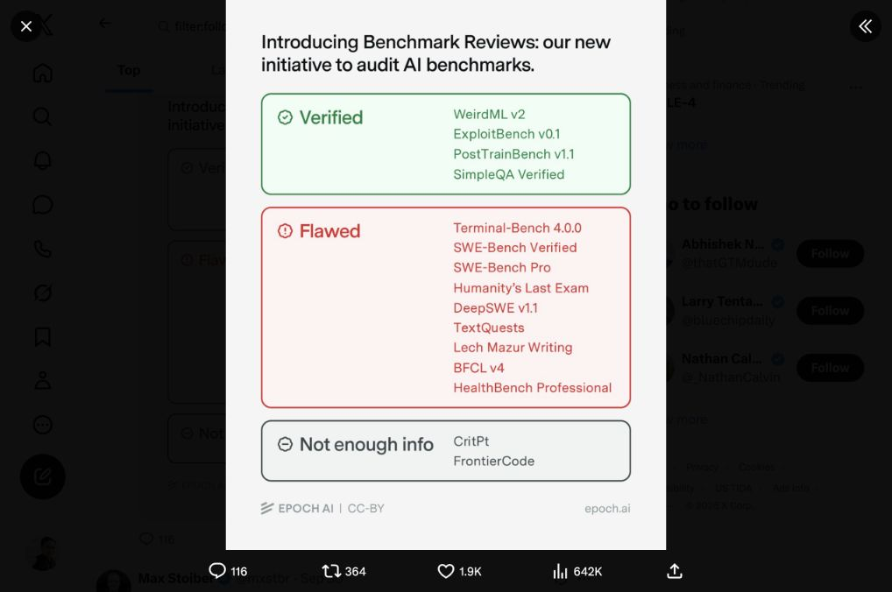

### Publish a research finding with its chart

- [@EpochAIResearch — survey chart](https://x.com/EpochAIResearch/status/2047056309535801605), April 22, 2026; 76.7K followers; 2,007 likes.
- Full text: [read the original post](https://x.com/EpochAIResearch/status/2047056309535801605). The complete post was read but is too long to reproduce here.
- Format: lead with a numerical contrast and attach the source-labeled chart; the chart carries the comparison and survey notes.

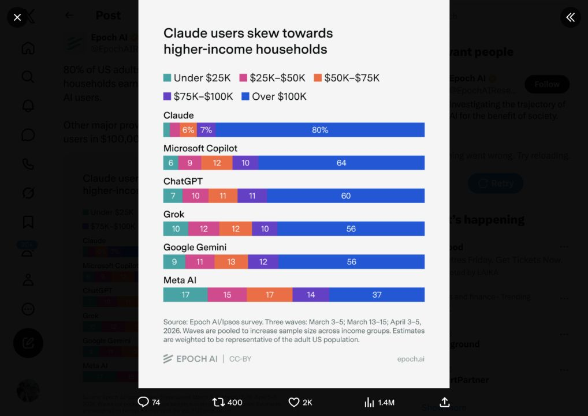

## Promote creative work with a demo

### Show how a launch video was made

- [@jxnlco — Codex launch video](https://x.com/jxnlco/status/2047382140854342073), April 23, 2026; 139.3K followers; 1,038 likes. The profile showed @swyx was following.
- Full post:

  > codex made its own launch video

- Format: one short line explaining the premise, with the directly attached 12-second video doing the showing. The author's follow-up gives production detail.

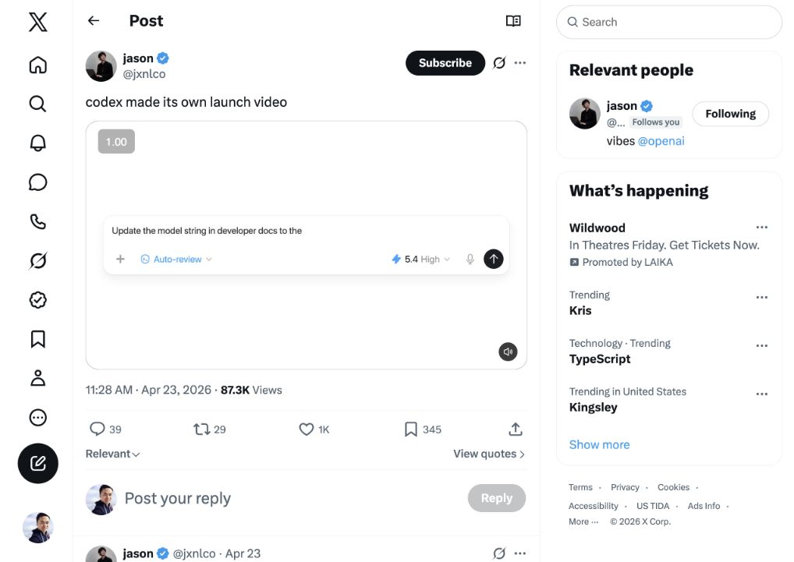

### Cost comparison plus animation

- [@EHuanglu — animation](https://x.com/EHuanglu/status/2045883787180118523), April 19, 2026; 147.3K followers; 2,388 likes.
- Full post:

  > $25 AI animation.. worth $500k just 2 months ago

- Format: a short cost comparison plus a directly attached 44-second demo. The video shows the work, not independent proof of the cost claim.

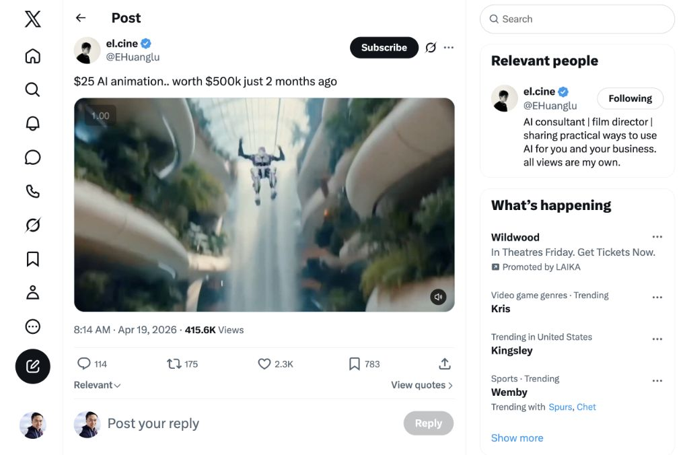

### Contrast setup plus demonstration

- [@EHuanglu — animators and AI](https://x.com/EHuanglu/status/2028240575552475520), March 1, 2026; 147.3K followers; 4,251 likes.
- Full post:

  > Animators: we need 3 months
  >
  > AI: give me a minute

- Format: two contrasting lines and a directly attached 42-second demonstration. The post also quotes the author's separate post with a 15-second video.

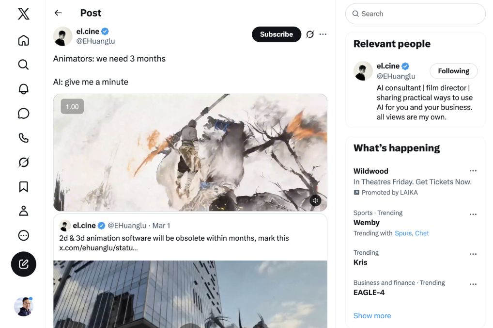
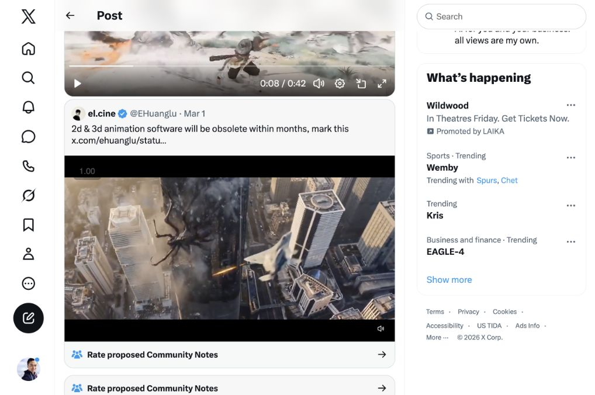

## Share a curated artifact

### Offer access to expertise

- [@jxnlco — computer-use AMA](https://x.com/jxnlco/status/2070577704752267321), June 26, 2026; 139.3K followers; 1,856 likes in X's embedded-post data.
- Full post:

  > I’m top 5 Computer Use users at OpenAI
  >
  > Ask me anything.

- Format: a concrete claim of first-hand experience followed by a direct invitation. X's embed lists no attachment, quote, or link card.

### Tier list

- [@Hi_Mrinal — engineering blogs tier list](https://x.com/Hi_Mrinal/status/2111384448373772369), October 17, 2026; 24.2K followers; 2,659 likes.
- Full post:

  > My tier list of companies based on their tech blogs

- Format: a one-line description of the artifact and the artifact itself, with a self-quote referring to an earlier plan.

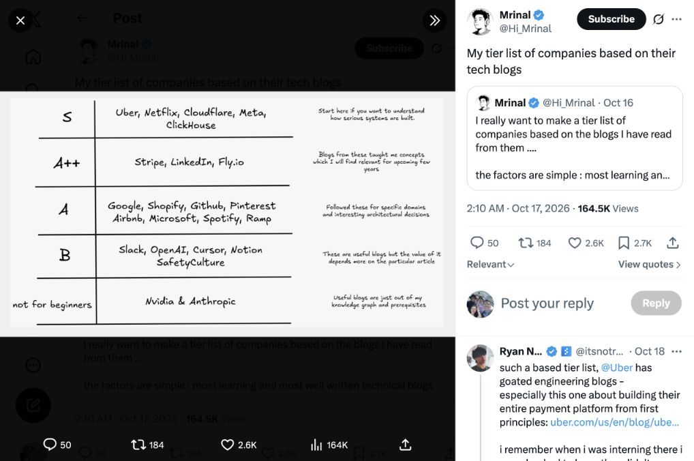

## Explain a topic via a quote post

### Aakash Gupta's explanatory quote

- [@aakashgupta — cryptography research](https://x.com/aakashgupta/status/2111699549949714708), October 17, 2026; 335K followers, explicitly excepted from the 200K cap; 1,557 likes.
- Full text: [read the original post](https://x.com/aakashgupta/status/2111699549949714708). The expanded post was read but is too long to reproduce here.
- Format: a long explanatory narrative built around a quote post. No attached media was observed. One example is not enough to characterize Aakash's full range; collect more when access recovers.
