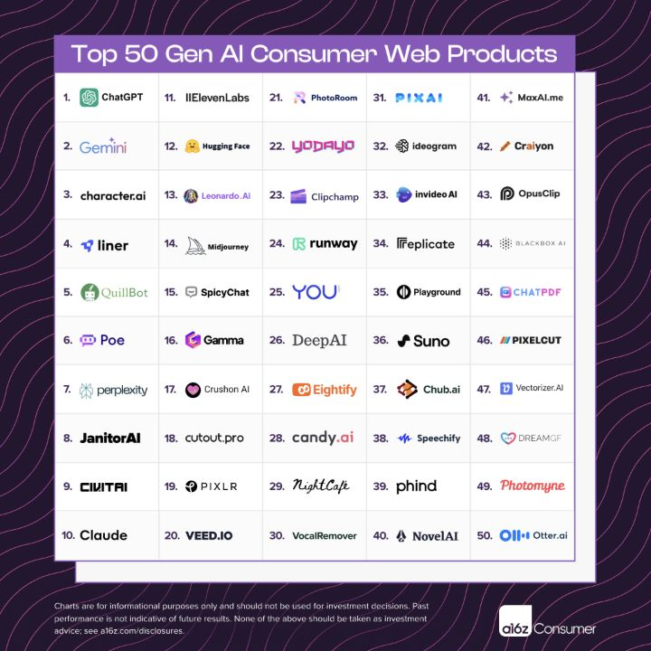
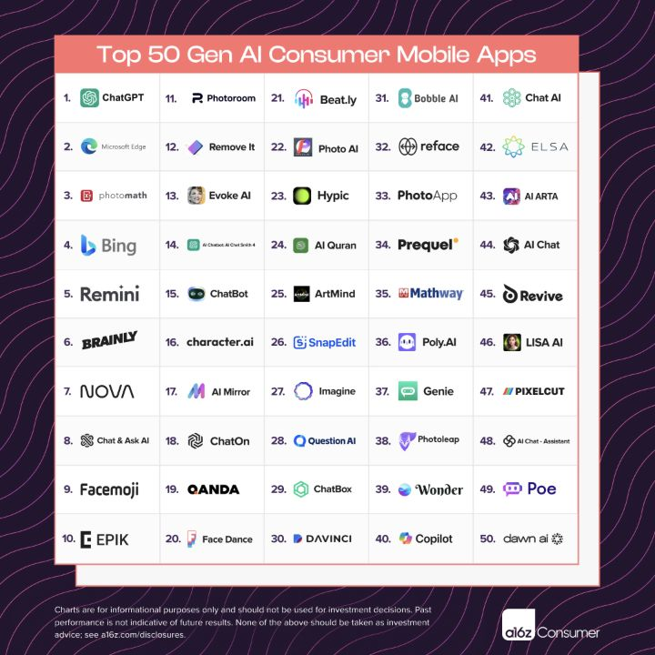
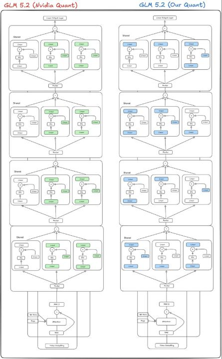
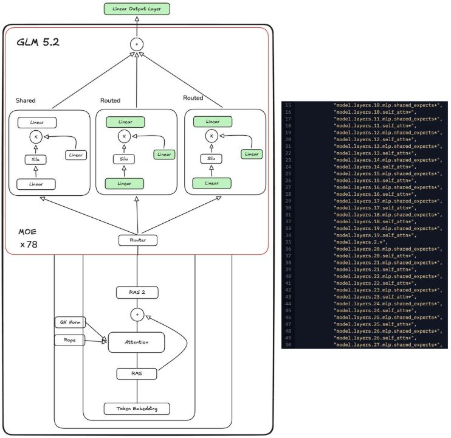
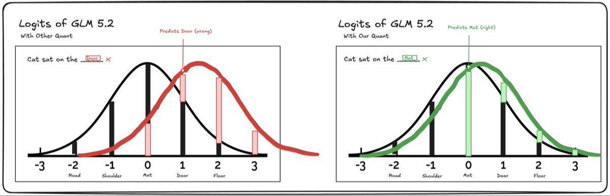
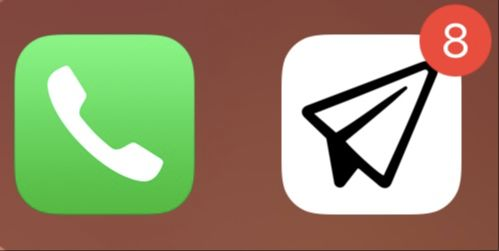

# Partial examples with captured media

These posts are still in the research queue and are not counted as complete
examples. Some media was inspected, but their full text or quoted media still
needs verification. Open the original before using them as writing models.

## Share a report through the artifact itself

- [@omooretweets — Top 100 consumer AI apps](https://x.com/omooretweets/status/1767934284172779933), March 13, 2024; 1,080 likes in X's embedded-post data. Complete wording still needs verification.
- The post attaches two ranked charts: 50 web products and 50 mobile apps. These are direct attachments, not separate preview cards.

## Promote a research paper with an illustrated explainer

- [@waterloo_intern — quantization research](https://x.com/waterloo_intern/status/2077229278899704265), July 15, 2026; 534 likes in X's embedded-post data. The full long-form post was read in an [archived profile](https://twiscan.com/en/x/waterloo_intern).
- It directly attaches three explanatory graphics and quotes [Joshua Hill's paper announcement](https://x.com/the_joshua_hill/status/2077203305105952897). The quoted post's media has not yet been inspected, so this remains a partial capture.

## Tease a feature with an app-icon image

- [@milichab — upcoming Notion Mail](https://x.com/milichab/status/1859678527567929375), November 21, 2024; 294 likes in X's embedded-post data. Earlier authenticated research observed 64.8K followers and that @swyx followed the author.
- Full post: “Soon @NotionMail https://t.co/HMhqvZnIhR”. The direct image shows a phone icon beside a mail icon with a notification badge. The quoted post's separate image still needs inspection.

